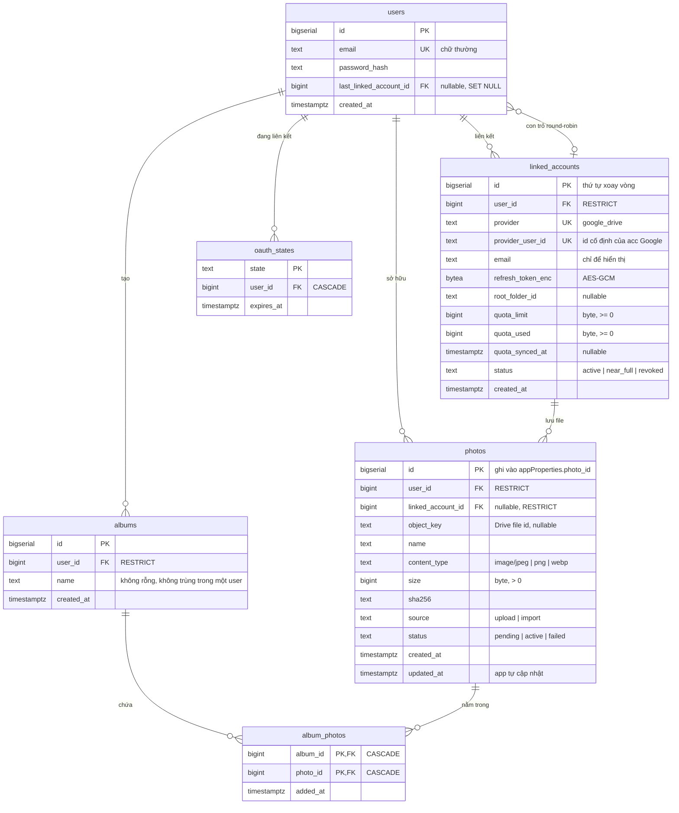
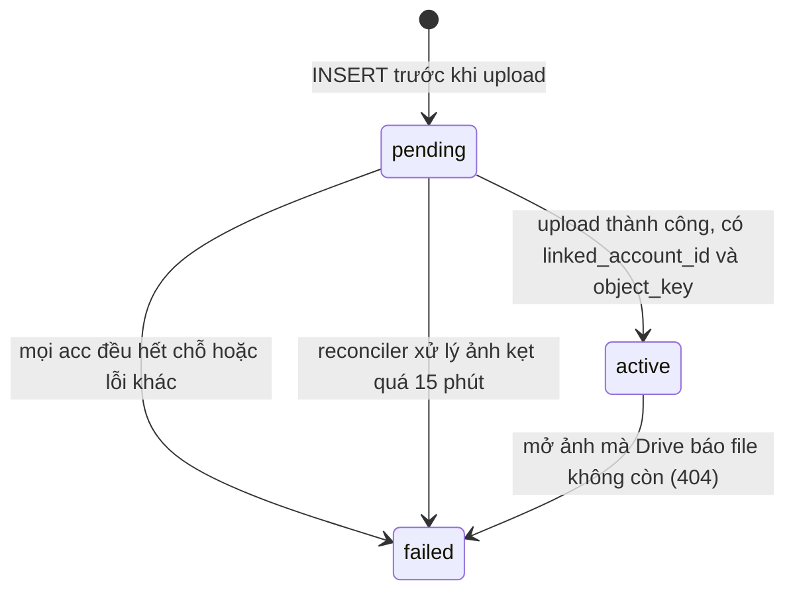

# Database schema

Schema hiện tại sau 5 migration trong `db/migrations/` (version 5).

## Sơ đồ quan hệ

## Khoá ngoại và hành vi khi xoá

| Từ | Tới | `ON DELETE` | Lý do |
|---|---|---|---|
| `linked_accounts.user_id` | `users.id` | `RESTRICT` | Không xoá user khi còn acc đã liên kết |
| `photos.user_id` | `users.id` | `RESTRICT` | Xoá theo sẽ để lại file mồ côi trên Drive |
| `photos.linked_account_id` | `linked_accounts.id` | `RESTRICT` | Ảnh phải biết file nằm ở acc nào |
| `oauth_states.user_id` | `users.id` | `CASCADE` | `state` là dữ liệu tạm, sống khoảng 10 phút |
| `users.last_linked_account_id` | `linked_accounts.id` | `SET NULL` | Mất con trỏ thì vòng xoay bắt đầu lại từ đầu |
| `albums.user_id` | `users.id` | `RESTRICT` | Không xoá user khi còn album |
| `album_photos.album_id` | `albums.id` | `CASCADE` | Dòng nối không còn nghĩa khi album mất |
| `album_photos.photo_id` | `photos.id` | `CASCADE` | Dòng nối không còn nghĩa khi ảnh mất |

**Album là quan hệ nhiều-nhiều:** một ảnh nằm được trong nhiều album qua bảng nối `album_photos`. Album chỉ là metadata trong DB, không tạo folder trên Drive, vì một album có thể chứa ảnh nằm trên nhiều acc Google.

**FK vòng tròn:** `users` và `linked_accounts` trỏ lẫn nhau. Migration 1 tạo `users` chưa có FK con trỏ, migration 2 tạo `linked_accounts` rồi mới thêm FK đó.

## Ràng buộc

| Bảng | Ràng buộc | Chặn trường hợp nào |
|---|---|---|
| `users` | `email = lower(email)`, `UNIQUE (email)` | Hai tài khoản chỉ khác nhau ở chữ hoa, chữ thường |
| `linked_accounts` | `UNIQUE (provider, provider_user_id)` | Một acc Google thuộc về hai user |
| `linked_accounts` | `status IN (...)`, quota `>= 0` | Trạng thái lạ, quota âm |
| `photos` | `content_type IN (...)`, `size > 0`, `status IN (...)`, `source IN (...)` | Loại file lạ, file rỗng, trạng thái lạ |
| `photos` | `photos_active_has_location` | Ảnh `active` mà thiếu `linked_account_id` hoặc `object_key` |
| `albums` | `name <> ''`, `UNIQUE (user_id, name)` | Album không tên, hai album trùng tên trong một user |
| `album_photos` | `PRIMARY KEY (album_id, photo_id)` | Một ảnh bị thêm hai lần vào cùng album |

## Index

| Index | Cột | Phục vụ |
|---|---|---|
| `linked_accounts_rotation_idx` | `(user_id, status, id)` | Lấy acc của user theo thứ tự xoay vòng |
| `photos_gallery_idx` | `(user_id, status, created_at DESC, id DESC)` | Gallery phân trang bằng cursor `(created_at, id)` |
| `photos_reconcile_idx` | `(status, updated_at)` | Reconciler tìm ảnh `pending` quá 15 phút |
| `oauth_states_expires_at_idx` | `(expires_at)` | Dọn các `state` đã hết hạn |
| `album_photos_photo_idx` | `(photo_id)` | Tìm các album chứa một ảnh |

Các index tự có từ `PRIMARY KEY` và `UNIQUE` không liệt kê ở đây.

## Vòng đời của một ảnh

## Câu hỏi khi review

- `album_photos` có thể nối album của user này với ảnh của **user khác** không? DB hiện không chặn, app phải kiểm tra cả hai thuộc cùng user.
- Gallery trong một album phải join `album_photos` với `photos` rồi sắp theo `(created_at, id)`. Khi album có rất nhiều ảnh, index hiện tại có đủ không?
- `users.last_linked_account_id` có thể trỏ tới acc của **user khác** không? DB hiện không chặn, app phải tự đảm bảo.
- `photos.sha256` chưa có `UNIQUE`. Có nên chặn upload trùng ở mức DB không, và theo phạm vi từng user hay toàn hệ thống?
- `quota_used` có nên bị chặn không vượt `quota_limit` không? Gợi ý: Google có thể báo số dùng lớn hơn giới hạn.
- `updated_at` không có trigger. Nên dùng trigger, hay để mỗi câu `UPDATE` tự đặt `updated_at = now()`?
